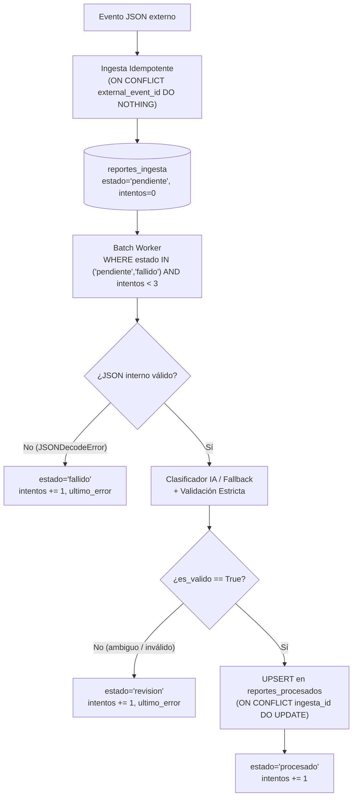

# resilient-report-processor

Sistema de ingesta idempotente y procesamiento resiliente por lotes para reportes operativos y ciudadanos, con validación estricta sobre salidas de IA y tolerancia a fallos.

---

## 1. Problema y Objetivo

Las integraciones basadas en webhooks, formularios o colas externas suelen sufrir tres problemas clásicos:

1. **Entregas duplicadas:** El emisor reintenta un evento por *timeout* y genera registros repetidos.
2. **Payloads corruptos o incompletos:** Un JSON malformado o un campo faltante detiene todo el lote si no se aísla el fallo.
3. **Salidas impredecibles de IA:** Un modelo de lenguaje puede responder categorías inventadas, tipos incorrectos o texto libre en lugar de la estructura esperada.

**Objetivo:** Garantizar que ningún evento válido se pierda ni se duplique, aislar los casos corruptos o ambiguos sin detener el lote, y asegurar que solo datos estrictamente validados lleguen a la tabla final de negocio.

---

## 2. Diagrama de Flujo



---

## 3. Decisiones de Arquitectura

### Separación entre `reportes_ingesta` y `reportes_procesados`
- **`reportes_ingesta`** actúa como bitácora cruda e inmutable del evento recibido (`payload_raw` como `TEXT`), junto con su estado operativo (`pendiente`, `procesado`, `revision`, `fallido`), contador de `intentos` y `ultimo_error`. Guardar el payload como texto evita que la base de datos rechace un evento corrupto en la ingesta.
- **`reportes_procesados`** contiene únicamente información estructurada, normalizada y validada (`categoria`, `prioridad` entera `1..5`, `resumen`), vinculada 1:1 mediante `ingesta_id UNIQUE`.

### Garantía de idempotencia en dos niveles
1. **En ingesta:** `external_event_id` tiene restricción `UNIQUE` y se inserta con `ON CONFLICT (external_event_id) DO NOTHING`. Reintentar la entrega del mismo evento no genera duplicados.
2. **En procesamiento:** `_guardar_reporte_procesado` usa `ON CONFLICT (ingesta_id) DO UPDATE`. Si un registro que antes falló se corrige y se reprocesa, actualiza la fila en lugar de duplicarla.

### Validación determinista sobre la salida de IA / Fallback
El módulo `src/classifier.py` nunca confía ciegamente en la respuesta del modelo:
- `categoria` debe pertenecer a `{"infraestructura", "operaciones", "acceso", "otro"}`.
- `prioridad` debe ser un entero entre `1` y `5` (excluyendo booleanos explícitamente, ya que en Python `isinstance(True, int)` es `True`).
- `resumen` debe ser un `str` no vacío.
- Si no hay `OPENAI_API_KEY` o falla la llamada externa, actúa `_clasificador_fallback`. Si el reporte es ambiguo (ej. sin ubicación o severidad válida), se marca `es_valido=False` y pasa a `revision` sin escribir en `reportes_procesados`.

### Retorno estructurado y códigos de salida
- Cada ítem procesado devuelve un `ResultadoProcesamiento` (`dataclass` inmutable con `event_id`, `estado_final`, `ok`, `codigo_error`, `mensaje`, `datos`), sin depender de `print`.
- Al finalizar la corrida, el orquestador imprime un único objeto JSON `run_summary` (`batch_size`, `leidos`, `procesados`, `revision`, `fallidos`, `duracion_ms`) y devuelve código de salida `0` si el lote completó o `1` solo ante fallos fatales de infraestructura.

---

## 4. Cómo ejecutarlo localmente (SQLite)

Requiere **Python 3.12+** (sin dependencias externas para el modo SQLite).

```powershell
# 1. (Opcional) Limpiar la base local para iniciar desde cero
Remove-Item -ErrorAction SilentlyContinue data/reports.db

# 2. Primera ejecución: inicializa sql/schema_sqlite.sql, ingiere data/sample_events.json y procesa el lote
python src/processor_sqlite.py --batch-size 50

# 3. Segunda ejecución inmediata: verifica idempotencia y reintento controlado de fallidos
python src/processor_sqlite.py --batch-size 50
```

En la **primera ejecución**, el `run_summary` reporta `leidos: 3` (`procesados: 1`, `revision: 1`, `fallidos: 1`; el evento duplicado del JSON se ignora en la ingesta).  
En la **segunda ejecución**, la ingesta ignora los 4 eventos existentes y `process_pending` solo reintenta el registro en `fallido` (`intentos < 3`), devolviendo `leidos: 1, fallidos: 1`. Tras alcanzar `intentos = 3`, el script devolverá `leidos: 0`.

---

## 5. Límites conocidos y próximos pasos (hacia PostgreSQL en producción)

- **Concurrencia real:** En SQLite el archivo se bloquea al escribir. Al migrar a PostgreSQL (`sql/schema.sql` y `src/processor.py`), la consulta usa `FOR UPDATE SKIP LOCKED`, permitiendo correr múltiples *workers* en paralelo sin que procesen el mismo registro.
- **Backoff exponencial real:** Actualmente los registros en `fallido` se reintentan en la siguiente corrida mientras `intentos < 3`. En producción conviene agregar una columna `proximo_reintento_en` (`TIMESTAMPTZ`) para espaciar reintentos (ej. 1 min, 5 min, 15 min).
- **Desacoplamiento con colas:** Para alto volumen, la ingesta HTTP puede publicar el `ingesta_id` en una cola (Redis/SQS/RabbitMQ) para disparar *workers* bajo demanda en lugar de hacer *polling* periódico.
